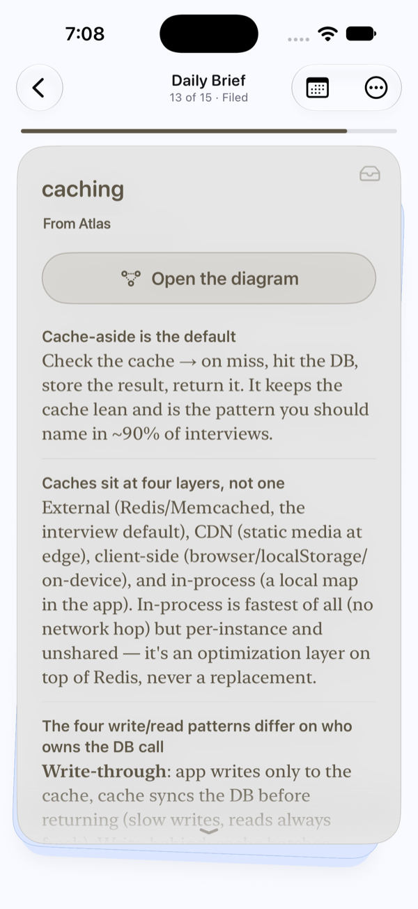
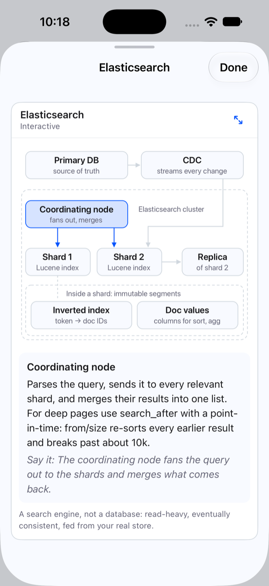
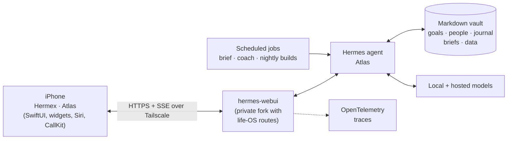

<div align="center">


# Hermex · Atlas

**A personal life OS on iPhone, run by a self-hosted AI agent.**

A native SwiftUI fork of [Hermex](https://github.com/uzairansaruzi/hermex) that turns a phone client for a [Hermes](https://github.com/nesquena/hermes-webui) agent into the daily surface for one person's goals, knowledge, health, and career, with the agent doing the work in the background on hardware they own.

</div>

## The idea

Most AI apps are a chat box. This one starts from the other end: an agent (called **Atlas**) runs on a Mac at home, keeps a markdown "second brain", runs scheduled jobs overnight, and writes its results as structured files. The phone is where you meet that work: a morning brief to swipe through, goals to check off, an interview tutor, a voice line to call, and an inbox where the app's own bugs get fixed by the agent while you sleep.

Nothing runs on a hosted backend. Models, memory, and personal data stay on the home machine, and the phone reaches it over Tailscale.

<div align="center">
<table>
  <tr>
    <td align="center"><br /><sub><b>A card from the Daily Brief</b></sub></td>
    <td align="center"><br /><sub><b>Its interactive diagram</b></sub></td>
  </tr>
</table>
</div>



## Life OS

| | What it does |
|---|---|
| **Daily Brief** | Each morning and evening the agent writes the day's brief, and the app shows it as a swipeable deck: priorities, decisions waiting on you, a goal check-in, the week ahead, what changed overnight (with Undo), reflection prompts, and a closing card. Hold to fan the stack, tap to open a card full screen, pull past the end to leave feedback. Weekly and monthly "Wrapped" decks recap the period. |
| **Goals** | Goals with daily or weekly commitments, check-ins, and counts that fill in automatically from other modules. "New goal" opens a chat where the agent interviews you and drafts the plan; a weekly coach reviews progress. Finishing a goal plays a one-time celebration and keeps a permanent record with your reflection. |
| **Brain** | A read-only library over the agent-maintained knowledge vault: an Ask home with suggestion chips, a daily review deck, a reader that leads with connections between notes, highlights, a journal calendar, and People pages that surface who you're due to catch up with. |
| **Prep** | An AI interview tutor laid out as a course path: lessons, recall-first quizzes, a gap ledger, a STAR story bank with timed spoken drills, and a voice mock-interview ladder (behavioral and system design) that ends in a rubric-graded result. |
| **Sleep** | Wearable sleep data as a card in the brief and a full Sleep screen: hypnogram, trends over 1W–1Y, HRV, and a nightly rating with notes. |
| **Money** | A net-worth view with a scrubbable chart, a weekly market card, and accounts. Amounts start hidden and re-hide whenever you leave the screen. |
| **Daily practice** | Small daily cards for habits, such as language practice that plays phrases and takes spoken answers through on-device dictation. |

## AI features

- **Voice calls with the agent.** A hands-free "Call Atlas" screen built on CallKit, with live captions and an animated orb. Speech recognition runs on device (`SpeechAnalyzer` on iOS 26, `SFSpeechRecognizer` before), biased toward your contacts and vocabulary. Turn detection is voice-activity based, replies use the server's neural voice with Apple TTS as fallback, and tool approvals can be granted by voice.
- **Interactive answers.** When the agent replies with a small HTML tool (a calculator, a chart, a diagram), it renders inline as a live card in a sandboxed `WKWebView`. A bridge validates every message the card sends before the app acts on it. The same renderer draws the brief's system-design diagrams.
- **A self-improving app.** Send feedback from any screen, with a screenshot and the screen's context attached. A nightly agent turns each note into a plan you steer with tappable answers, builds the fix in a sandbox, and puts it in an inbox grouped by what it's waiting on: You said → Plan → Build → Merge. Ready fixes merge with one tap, and shipped ones can be undone. A label queue rates generated cards to build eval sets.
- **Agent activity.** A timeline of what the agent did on its own, grouped into episodes by day, alongside the rules that triggered them.
- **Turn tracing.** Each chat turn carries a W3C `traceparent` and reports its timing (time to first token, connection type, outcome), never message text, so latency can be followed from the phone through the server and agent to the model in OpenTelemetry.
- **Widgets and Siri.** An "Ask Atlas" home and lock screen widget with dictation and recent chats, an interactive Goals widget that checks off commitments without opening the app, and Shortcuts actions for New Chat, New Voice Chat, and Call Atlas.

## Inherited from Hermex

Everything from upstream Hermex still works: streaming chat with thinking and tool-call detail, steer and stop, sessions with an offline cache, model and profile pickers, scheduled Tasks, Skills, a workspace browser, Kanban, Bot Mode, the share extension, and Live Activities.

## Design

The fork has its own design system, [DESIGN.md](DESIGN.md): **calm chat, colorful objects**. Chat sits on neutral navy-tinted surfaces; each kind of object (a goal, a person, a brief card) wears one fixed "paper" color rendered as a glow; accent blue is only for controls. SF Pro Rounded is the display voice, serif is reserved for your own saved words, contrast is enforced by tests, and every animation respects Reduce Motion.

## How it's built

- **Native SwiftUI** for iOS 18+, with `@Observable` view models and an `APIClient` actor. Long-lived SSE streams reattach after backgrounding.
- **The server owns the work.** Life-OS features read structured files the agent writes into its workspace (`briefs/<date>.<kind>.json`, sleep and money snapshots) or call fork-only routes on hermes-webui (`/api/goals`, `/api/brain`, `/api/tutor`, `/api/feedback`). Each feature treats a missing route as "not on this server" and hides itself, so the app still works against a stock server.
- **No new dependencies.** Apple frameworks plus the upstream locked list: CallKit, Speech, WidgetKit, App Intents, WebKit, SwiftData, Keychain.
- **Tested against fixtures, not a live server.** Unit tests use `URLProtocol` mocks, scripted SSE fixtures, and synthetic data.

## Running it

This is a personal fork and the server routes behind the life-OS features live in a private hermes-webui fork, so out of the box you get the upstream Hermex experience plus whichever fork features your server supports.

1. Run [hermes-webui](https://github.com/nesquena/hermes-webui) and make it reachable from your phone (Tailscale Serve or an HTTPS tunnel).
2. Open `HermesMobile.xcodeproj` in Xcode 26+, set your own development team, and run the `HermesMobile` scheme.

```zsh
xcodebuild -project HermesMobile.xcodeproj -scheme HermesMobile -destination 'platform=iOS Simulator,name=iPhone 17' build
```

[DEVELOPMENT.md](DEVELOPMENT.md) has the details.

## Credits and license

Hermex is created and maintained by [Uzair Ansar](https://github.com/uzairansaruzi/hermex); get the App Store version at [hermexapp.com](https://hermexapp.com). This fork builds on it under the MIT license, see [LICENSE](LICENSE). It is not affiliated with the upstream Hermex or [hermes-webui](https://github.com/nesquena/hermes-webui) projects.

The file-type icons in the workspace tree are [Pierre](https://pierre.co)'s `@pierre/trees` icons (Apache-2.0) with six additions from [T3 Code](https://github.com/pingdotgg/t3code) (MIT).
